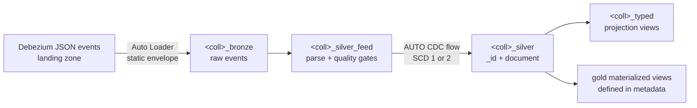

# debezium-mongodb-cdc-pipeline — metadata-driven schemaless CDC

A metadata-driven framework for ingesting Debezium (MongoDB)
change-data-capture events into a Unity Catalog medallion architecture,
built on **Lakeflow Declarative Pipelines** (`pyspark.pipelines`) and
the **VARIANT** data type — no schema inference, no schema registry,
no reload on schema drift.

Adding a source collection — the 10th or the 100th — is one entry in
`config/collections.yaml`. No code changes.

Companion projects:
[debezium-cdc-pipeline](https://github.com/morillo/debezium-cdc-pipeline)
(the relational/MySQL twin of this framework),
[dlt-debezium-mysql](https://github.com/morillo/dlt-debezium-mysql) and
[dlt-debezium-mongodb](https://github.com/morillo/dlt-debezium-mongodb)
(single-source pipelines).

## Why MongoDB CDC needs no schema machinery here

Debezium's MongoDB connector emits each document as a single JSON
string with no schema metadata — MongoDB is schemaless, so there is
nothing to describe. Historically that gap was closed with custom
schema inference (`schema_of_json()`/`from_json()` plus a stored
schema registry). This framework closes it with types instead:

- the **envelope is static and identical for every collection** (the
  document travels as a string), so there is no per-collection schema
  to derive — the exact opposite of the relational twin;
- the **document is stored as VARIANT** (`parse_json`), so drift is a
  non-event and consumers project types at read time;
- typed access is **declared in metadata** as projection expressions,
  materialized per collection as a `<name>_typed` view.

## Architecture



Per collection in the metadata, the pipeline registers:

| Dataset | Kind | Purpose |
|---|---|---|
| `<name>_bronze` | streaming table | Raw Debezium envelopes via Auto Loader (static schema). |
| `<name>_silver_feed` | temporary view | Document parsed, `_id` extracted (ObjectId / scalar / composite), `_cdc_*` bookkeeping, expectations applied. |
| `<name>_silver` | streaming table | AUTO CDC merge keyed on `_id`, sequenced by `(ts_ms, oplog ord)`, deletes applied. |
| `<name>_typed` | materialized view | Optional typed projection from metadata (current rows only for SCD2). |

Gold materialized views are declared entirely in metadata (`name` +
`sql`) and can join collections on VARIANT extractions.

## VARIANT and SCD types — an engine constraint worth knowing

Discovered and verified on a live workspace:

- **SCD type 1** (current state): the document is stored as **VARIANT**
  — merge works, drift is free, this is the default and the fast path.
- **SCD type 2** (full history): the engine tracks history by comparing
  consecutive row versions, and VARIANT does not support equality
  comparison (`INVALID_ORDERING_TYPE`). For SCD2 collections the
  framework therefore stores the document as **canonical JSON text**
  (`doc_json`) — deterministic, so cosmetic key-order differences
  cannot create phantom history rows — and the typed projection view
  parses it back to a `doc` VARIANT, so **projection metadata is
  identical for both SCD types**.

The only place the difference shows is SQL you write yourself against
an SCD2 silver table: use `doc_json:path` instead of `doc:path` (the
`:` operator works on JSON strings natively).

## How a collection is configured

```yaml
collections:
  - name: customers
    source_database: shopdb   # or inherit from `defaults:`
    scd_type: 2               # keep full history
    cluster_by: [_id]
    projection:
      - "doc:name::string AS name"
      - "doc:address.city::string AS city"
      - "cast(doc:signup['$date']::long / 1000 as timestamp) AS signup_at"
    expectations:
      drop:
        valid_email: >-
          doc_json:email IS NULL OR doc_json:email::string LIKE '%@%'
```

The landing path defaults to `{landing_root}/{topic_template}`
(`mongodb.<database>.<name>`), `{env}` placeholders resolve to the
`cdc.environment` pipeline setting, and `path:` overrides per
collection. The merge key is always the document `_id`, extracted from
extended JSON whatever its shape: `{"$oid": ...}`, plain scalars, or
composite keys (kept as canonical JSON text).

Built-in safeguards for every collection: Kafka tombstones and events
without a resolvable `_id` (including deletes emitted without
pre-images) are dropped and counted in the event log, and events are
sequenced by `struct(ts_ms, ord)` so same-millisecond changes to a
document resolve deterministically by oplog ordinal.

Connector requirements: `capture.mode=change_streams_update_full` and
pre-images enabled (`change_streams_with_pre_images`) if deletes must
be applied.

## SDLC: dev → test → prod

The bundle defines three targets; each pins a Unity Catalog catalog
(`cdc_dev` / `cdc_test` / `cdc_prod`) and an environment name that
resolves the landing paths. Code and metadata are identical across
environments — only configuration differs.

```bash
databricks bundle validate -t dev
databricks bundle deploy   -t dev     # per-user dev copy (mode: development)
databricks bundle run      -t dev debezium_mongodb_cdc

databricks bundle deploy   -t test    # via CI, as a service principal
databricks bundle deploy   -t prod    # via CI, gated release
```

Fill in the `workspace.host` (and `run_as` service principals for
test/prod) in `databricks.yml` before first use.

## CI/CD

`.github/workflows/ci.yml`: every PR runs `ruff` lint, `pytest` unit
tests (the metadata loader is Spark-free and runs on any CI runner),
and `bundle validate`; merges to `main` deploy to test and tags deploy
to prod — with all Databricks steps skipping gracefully when workspace
secrets are not configured.

## Running on Databricks Free Edition

Verified end-to-end on Databricks Free Edition (serverless). Use the
built-in `workspace` catalog and a volume for landing, and point
`landing_root` in `config/collections.yaml` at it:

```yaml
landing_root: /Volumes/workspace/landing/debezium
```

```bash
databricks schemas create cdc_mongo_fw workspace
databricks fs cp -r ./events/ \
  dbfs:/Volumes/workspace/landing/debezium/

databricks bundle deploy -t dev --var="catalog=workspace"
databricks bundle run    -t dev debezium_mongodb_cdc \
  --var="catalog=workspace"
```

The verification run covered three collections at once: SCD2 history
(update kept as a closed row plus a current row), the same-millisecond
update+delete tiebreak by oplog `ord`, pre-image deletes, a Kafka
tombstone, schema-drift documents (ObjectId and integer `_id`s, fields
present on one document only), a metadata-defined drop expectation
evaluated against the document, typed projections for both SCD types
(`$date` → timestamp, `$numberLong` → long), and a gold view joining
two collections on a VARIANT extraction — all confirmed correct.

## Project layout

```
debezium-mongodb-cdc-pipeline/
├── databricks.yml                     # Asset Bundle: dev/test/prod targets
├── resources/cdc_pipeline.pipeline.yml# Pipeline resource (UC catalog/schema)
├── config/collections.yaml            # Collection + gold metadata
├── src/
│   ├── cdc_pipeline.py                # Pipeline entry point
│   └── cdc_framework/
│       ├── config.py                  # Metadata model + validating loader
│       ├── debezium.py                # Envelope constants (Spark-free)
│       └── flows.py                   # Dataset factories (pyspark.pipelines)
├── tests/                             # Unit tests (run anywhere, no Spark)
└── .github/workflows/ci.yml           # Lint, test, validate, deploy
```
